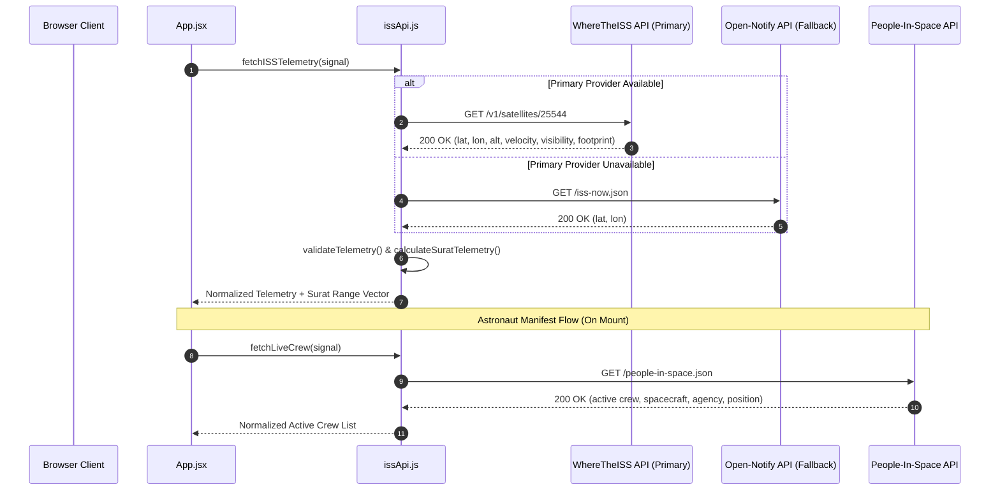

# OrbitLog — System Architecture & Technical Design

> **Project:** OrbitLog — Live ISS Satellite Tracker & Flight Operations Console  
> **Club:** ASTRA (Astronomy & Astrophysics Club), IIIT Surat  
> **Classification:** Aerospace Telemetry & Geospatial Web Instrument  

---

## 1. Architectural Philosophy

OrbitLog is designed around three core principles:
1. **Full-Viewport Tool-First Canvas:** Inspired by SpaceX Crew Dragon and Flightradar24, the interactive orbital map occupies 100% of the screen (`100vw × 100vh`). Telemetry is presented in tactical, non-intrusive HUD panels and a collapsible avionics console.
2. **Zero-Backend Client-Side Execution:** Operates completely in the client's browser runtime. All telemetry acquisition, verification, Haversine spherical trigonometry, and antimeridian coordinate segmenting happen in browser memory with zero backend dependencies.
3. **Automated Zero-Maintenance Feeds:** Both the satellite telemetry (`wheretheiss.at`) and the astronaut crew manifest (`corquaid.github.io/international-space-station-APIs`) query automated live APIs with offline fallbacks.

---

## 2. Component Hierarchy Diagram

```text
App (Root Component: Full-Viewport Canvas & Polling Lifecycle)
│
├── Header (h-14 Tactical Flight Bar)
│   ├── Satellite Vector Logo & OrbitLog Title
│   ├── Live UTC Mission Clock (HH:MM:SS UTC)
│   ├── Flight Console Toggle Trigger (CONSOLE Button)
│   ├── Live Telemetry Status Badge (Active / Stale / Offline)
│   ├── Map Recenter Trigger (CENTER Button)
│   ├── Polling Cadence Selector (5s, 10s, 30s)
│   ├── Auto/Manual Refresh Toggle
│   └── On-Demand SYNC Trigger
│
├── LiveMap (Full-Screen Leaflet Geospatial Engine)
│   ├── MapContainer (w-full h-full Leaflet Canvas)
│   ├── TileLayer (Esri Dark Canvas / Esri Satellite / OpenStreetMap)
│   ├── MapController (Programmatic Recenter & Pan)
│   ├── Polyline[] (Antimeridian-Segmented Dual Ground Track)
│   ├── Circle (Line-of-Sight Visibility Horizon Boundary)
│   ├── Marker [ISS Satellite] (Custom Inlined SVG & Radar Beacon)
│   │   └── Popup (Real-time telemetry tooltip)
│   ├── Marker [IIIT Surat Ground Station] (Pulse Marker at 21.17°N, 72.83°E)
│   │   └── Popup (Campus coordinates and station details)
│   └── Map Controls HUD (Tile switcher, Footprint toggle, Track trail toggle)
│
├── FlightConsole (Collapsible Left Avionics Drawer / Split View)
│   ├── Tab 1: Primary Telemetry (WGS-84 Coordinates, Altitude, Ground Speed, Mach, Power)
│   ├── Tab 2: IIIT Surat Ground Station Vector (Haversine Distance, Azimuth Heading, LOS Status)
│   └── Tab 3: Expedition Crew Manifest (Automated live astronauts, roles, spacecraft, agency)
│
└── OrbitTimeline (Floating Bottom Orbital Phase Strip)
    ├── Sub-Satellite Position & Altitude Indicator
    ├── Solar Phase Indicator (Daylight Transit vs. Orbital Eclipse Umbra)
    ├── IIIT Surat Proximity Gauge & Direct Line-of-Sight Alert
    └── Stale Data Watchdog Warning
```

---

## 3. Data Flow & Multi-Source Failover Sequence



---

## 4. Ground Station Spherical Trigonometry (IIIT Surat)

To compute the exact real-time ground distance and azimuth from the **IIIT Surat campus ($21.1702^\circ\text{ N}, 72.8311^\circ\text{ E}$)** to the moving satellite, OrbitLog uses spherical geometry:

### Great-Circle Ground Distance (Haversine Formula)

$$a = \sin^2\left(\frac{\Delta \phi}{2}\right) + \cos(\phi_1)\cos(\phi_2)\sin^2\left(\frac{\Delta \lambda}{2}\right)$$

$$d = 2 R \cdot \operatorname{atan2}\left(\sqrt{a}, \sqrt{1 - a}\right)$$

Where:
- $\phi_1, \lambda_1$ = IIIT Surat coordinates ($21.1702^\circ, 72.8311^\circ$)
- $\phi_2, \lambda_2$ = ISS instantaneous sub-satellite coordinates
- $R = 6,371\text{ km}$ (Earth mean radius)

### Forward Azimuth (Bearing from Surat to ISS)

$$\theta = \operatorname{atan2}\left(\sin(\Delta \lambda)\cos(\phi_2), \cos(\phi_1)\sin(\phi_2) - \sin(\phi_1)\cos(\phi_2)\cos(\Delta \lambda)\right)$$

### Direct Line-of-Sight (LOS) Determination

$$\text{Line of Sight} = \begin{cases} \text{Active / Overhead}, & \text{if } d \le \frac{\text{Footprint Diameter}}{2} \approx 2,200\text{ km} \\ \text{Below Local Horizon}, & \text{otherwise} \end{cases}$$

---

## 5. Antimeridian Date-Line Segmenting

To prevent Leaflet polylines from connecting coordinates across the $180^\circ$ meridian with distorted horizontal lines across the globe, the path is partitioned:

$$\text{If } |\lambda_i - \lambda_{i-1}| > 180^\circ \implies \text{Terminate current segment and begin new polyline segment}$$

---

## 6. Defensive Programming & Null Guards

To guarantee zero blank-screen crashes during cold boot, network delays, or initial render cycles:
- All optional telemetry fields are guarded by strict primitive type checks:
  ```javascript
  typeof suratTelemetry?.distanceKm === 'number'
  ```
- Eliminates JavaScript's loose inequality trap where `undefined !== null` evaluates to `true`.
