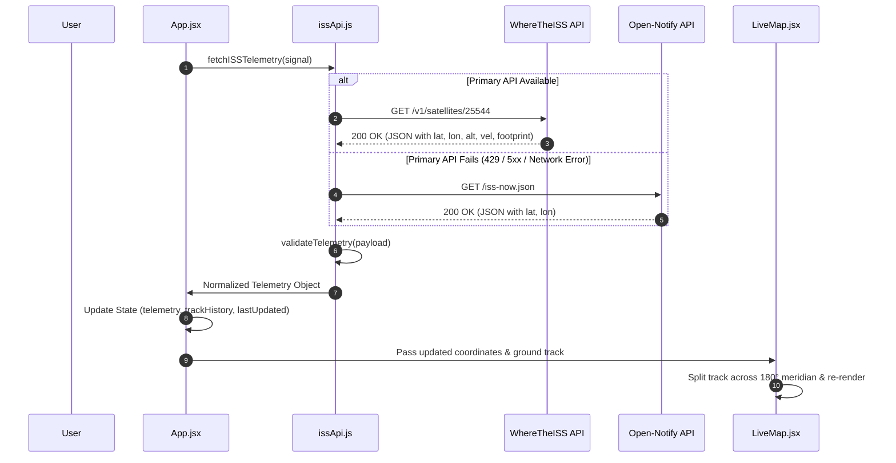

# ASTRA Orbit — System Architecture & Technical Design

> **Project:** ASTRA Orbit — Live ISS Satellite Tracker  
> **Team:** ASTRA (Astronomy & Astrophysics Club), IIIT Surat  
> **Classification:** Educational Aerospace Web Application  

---

## 1. Architectural Philosophy

ASTRA Orbit is built upon three primary architectural principles:
1. **Zero-Backend Client-Side Resilience:** Operates without a middle-tier server or database. All telemetry acquisition, verification, unit transformation, and geospatial projection take place directly inside the user's browser runtime.
2. **Deterministic Failover:** Integrates multi-provider failover. If the primary REST endpoint encounters network dropouts, rate limits, or DNS resolution errors, the client silently transitions to a secondary satellite endpoint without breaking UI state.
3. **Graceful Degraded & Stale States:** Distinguishes between live, buffered, stale, and offline conditions. Satellite tracking data is strictly labeled with source provenance and age.

---

## 2. Component Hierarchy Diagram

```text
App (Root Component: State Orchestrator & Polling Lifecycle)
│
├── Header
│   ├── Branding & Club Title (ASTRA IIIT Surat)
│   ├── Connection Status Badge (Active / Acquiring / Stale / Offline)
│   ├── Last Updated Timestamp
│   ├── Map Recenter Trigger ("Center ISS")
│   ├── Polling Interval Selector (5s, 10s, 15s, 30s)
│   ├── Auto-Refresh Toggle
│   └── Manual Sync Button
│
├── Telemetry Grid (6 Reusable Metric Tiles)
│   ├── TelemetryCard [Latitude - Geodetic / Decimal]
│   ├── TelemetryCard [Longitude - WGS-84 / Decimal]
│   ├── TelemetryCard [Altitude - km & mi / LEO Orbit]
│   ├── TelemetryCard [Velocity - km/h & km/s]
│   ├── TelemetryCard [Solar State - Daylight / Earth Shadow]
│   └── TelemetryCard [LOS Footprint - Communication Radius]
│
├── LiveMap (Interactive Geospatial Engine)
│   ├── MapContainer (Leaflet Engine)
│   ├── TileLayer (CartoDB Dark Matter / OpenStreetMap)
│   ├── MapController (Programmatic Camera Pan / Recenter)
│   ├── Polyline[] (Antimeridian-Segmented Ground Track)
│   ├── Circle (Line-of-Sight Visibility Horizon)
│   ├── Marker (Custom SVG Space Station & Pulse Beacon)
│   │   └── Popup (Real-time telemetry tooltip)
│   └── Map Controls HUD (Track toggle, Footprint toggle, Layer switch)
│
├── ISSInfoPanel (Science Reference & Educational Resource Deck)
│   ├── Orbital Parameters (Inclination, Period, Apogee, Perigee)
│   ├── Verified Station Facts
│   └── Curated Educational Resource Links
│
└── Footer (Attribution, API Credits & Datum Standards)
```

---

## 3. Telemetry Data Flow



---

## 4. State Management Model

| State Field | Type | Default | Description |
| :--- | :--- | :--- | :--- |
| `telemetry` | `object \| null` | `null` | Sanitized satellite coordinates, speed, altitude, and visibility. |
| `trackHistory` | `Array<{lat, lon, timestamp}>` | `[]` | FIFO ring buffer (capped at 80 points) of recent orbital coordinates. |
| `status` | `'loading' \| 'connected' \| 'error'` | `'loading'` | Macro network and telemetry health status. |
| `isFetching` | `boolean` | `true` | Micro state indicating an in-flight network request. |
| `lastUpdated` | `number \| null` | `null` | Unix timestamp of last valid telemetry acquisition. |
| `isStale` | `boolean` | `false` | Watchdog flag activated when telemetry age exceeds 30,000 ms. |
| `autoRefresh` | `boolean` | `true` | Controls the automatic polling timer. |
| `refreshInterval`| `number` | `5` | Polling cadence in seconds (5s, 10s, 15s, 30s). |
| `autoCenter` | `boolean` | `false` | When true, automatically pans the map camera to the satellite position. |

---

## 5. Antimeridian (International Date Line) Algorithm

Standard 2D map projections map Earth's longitude onto the interval $[-180^\circ, +180^\circ]$. When an orbital ground track crosses from the Eastern hemisphere ($+179.9^\circ$) into the Western hemisphere ($-179.9^\circ$), a naive polyline connects the two points by traversing across the entire map ($359.8^\circ$ span).

ASTRA Orbit solves this via coordinate segmenting:

$$\Delta \text{lon} = |\text{lon}_i - \text{lon}_{i-1}|$$

$$\text{If } \Delta \text{lon} > 180^\circ \implies \text{Split polyline into new segment}$$

This ensures that each continuous orbital arc terminates cleanly at the map edge and resumes on the opposite margin.

---

## 6. Performance & Memory Management

- **AbortController on Fetch Requests:** Avoids race conditions and ensures in-flight network promises are safely aborted when components unmount or intervals change.
- **Ring Buffer for History:** Ground track memory footprint is strictly bounded to the last 80 coordinates, preventing memory consumption from growing unbounded over multi-hour tracking sessions.
- **Marker Inlining:** Custom SVG satellite icon is rendered via `L.divIcon`, eliminating asset HTTP requests and preventing broken image path bugs in packaged builds.
